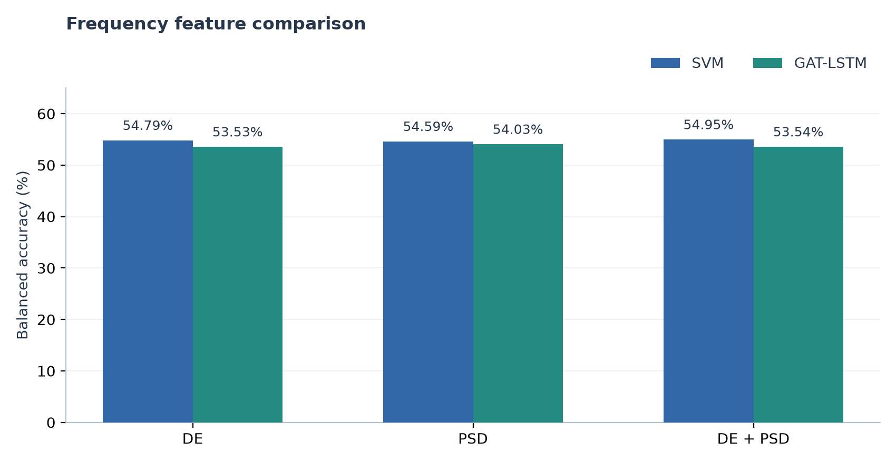
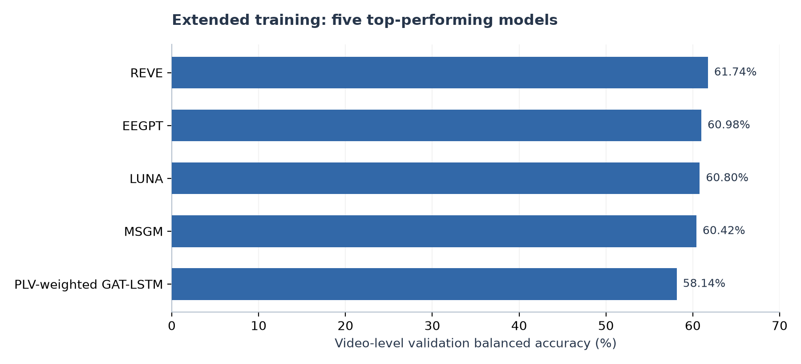
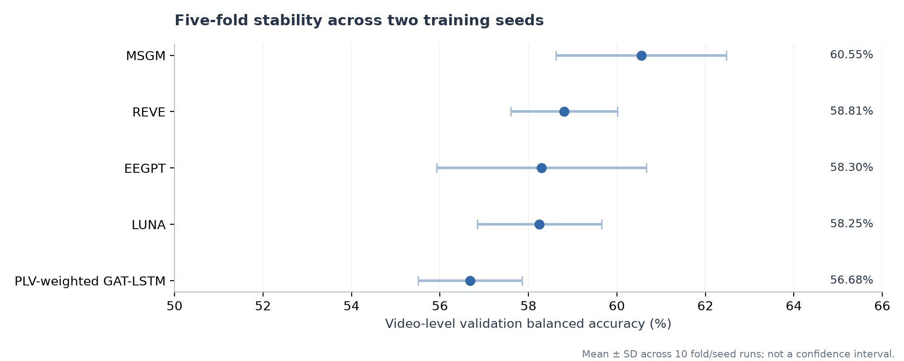
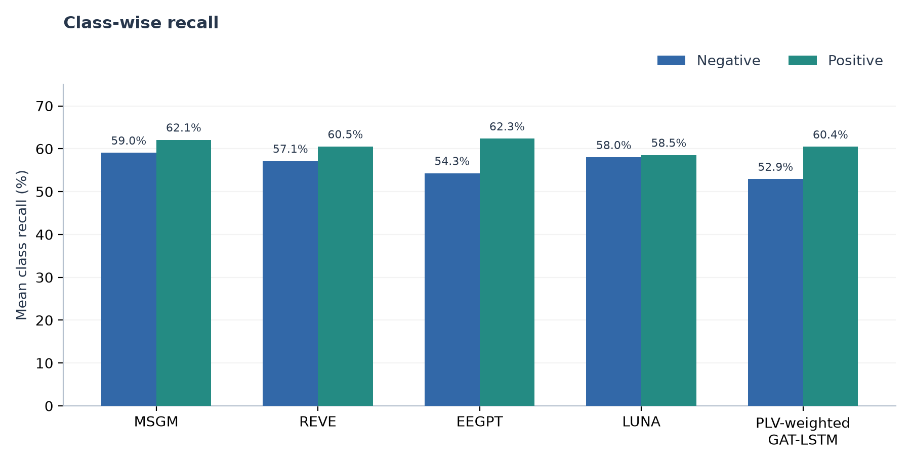

# EEG-Based Emotion Recognition Using Frequency Features and Deep Learning Models

**Author:** Amir Rajabi Heshin  
**Project:** Undergraduate thesis on EEG-based emotion recognition  
**Supervisor:** [Dr. Hossein Aghababa](https://www.loyola.edu/academics/engineering/faculty-staff/aghababa-hossein.html)

## Overview

This project focuses on emotion recognition using electroencephalography (EEG) signals. It began as an undergraduate thesis investigating EEG preprocessing, frequency-domain feature extraction, and deep learning models for emotion classification.

The repository now includes subsequent experiments with classical machine learning baselines, graph neural networks, pretrained EEG foundation models, and Mamba-based architectures. The work covers feature and architecture comparisons, reproduction studies, subject-disjoint validation, and analysis of prediction errors and computational cost. The current experimental focus is **binary emotion classification: negative versus positive** on FACED.

## Dataset

Dataset: *A Large Finer-grained Affective Computing EEG Dataset* ([FACED](https://doi.org/10.1038/s41597-023-02650-w)).

- **Participants:** 123
- **Video clips:** 28 per participant
- **Emotion categories:** 9 — anger, fear, disgust, sadness, neutral, amusement, inspiration, joy, tenderness
- **Preprocessed trials:** last 30 seconds of each video at 250 Hz
- **Binary task:** negative vs. positive; neutral trials excluded

Resources: [Dataset & code](https://www.synapse.org/Synapse:syn50614194) · [Paper & supplement](https://www.nature.com/articles/s41597-023-02650-w).

## Signal Processing and Neural Models

The initial experiments were conducted as part of the undergraduate thesis.

- **Exploration:** raw EEG classification was examined for eight non-neutral emotions and for positive/negative classification. Reported performance was near chance (12.5% and approximately 50%, respectively). The initial pipeline used non-overlapping two-second windows.
- **Feature processing:** DE and PSD were extracted across frequency bands, with filtering, baseline correction, and normalization explored through **14 data-loading configurations**.
- **Model comparison:** Vanilla LSTM, CNN-LSTM, bidirectional LSTM, attention LSTM, multi-branch CNN, Simple and Advanced [EEGNet](https://doi.org/10.1088/1741-2552/aace8c), [DeepConvNet](https://doi.org/10.1002/hbm.23730), and a residual 1D CNN were compared using loading configuration **#8**. This configuration was selected using CNN-LSTM and remained the preferred configuration in the loading-configuration checks.
- **Refinement:** the residual 1D CNN, DeepConvNet, and Simple EEGNet were shortlisted. Changes included dropout, SiLU activations, filter sizes, and classifier regularization. **Six training configurations** varied learning rate, weight decay, batch size, and the binary decision threshold.
- **Error analysis:** precision, recall, confusion matrices, ROC/PR curves, and relationships with arousal, valence, familiarity, and liking were examined. The initial analysis reported greater difficulty for low-arousal/low-liking samples.

### Selected residual CNN

**1D CNN with four residual blocks**, adaptive pooling, and an MLP classifier; loading configuration **#8**, training configuration **#3**. Early stopping ended at epoch **28**, with approximately **43 seconds per epoch**.

| Setting | Value |
| --- | --- |
| Optimizer | Adam |
| Learning rate / weight decay | 0.001 / 0.0001 |
| Batch size / decision threshold | 64 / 0.5 |

| Reported metric | Training | Test |
| --- | ---: | ---: |
| Accuracy | 89.15% | **72.14%** |
| Loss | 0.3933 | 0.6482 |

**Folders:** `models`, `configs`, `Analyze`, `results`, `utils`.

## Feature Ablation and Baselines

### Feature Comparison

DE, PSD, and their combination were compared with SVM and GAT-LSTM using **one-second, subject-disjoint out-of-fold test predictions across 123 participants and 10 folds**. Early nine-class GAT-LSTM experiments also compared mean-based and learned channel representations.

For SVM with DE + PSD, averaging decision scores over each video produced **57.01%** balanced accuracy, compared with **54.95%** at the one-second level. The aggregation analysis also compared mean, max, attention, and hierarchical graph readouts.

**Folders:** `Feature Ablation`, `New models`, `Signal Analysis`.

### DE Baselines

Five additional models were evaluated with DE features using **10-fold subject-disjoint evaluation at the one-second level**, with separate training, validation, and test participants within each fold.

| Model | Balanced accuracy | Macro F1 |
| --- | ---: | ---: |
| MLP | 54.60% | 0.5460 |
| Shrinkage LDA | 54.08% | 0.5407 |
| Logistic Regression | 54.45% | 0.5445 |
| Extra Trees | 54.15% | 0.5415 |
| HistGradientBoosting | 53.50% | 0.5350 |

**Folder:** `Simple Models`.

## FACED Reproduction Study

The released DE features were verified against the provided preprocessed EEG. Binary SVM experiments then examined five-band features, removal of each frequency band, the released final-fold normalization behavior, and a corrected alternative. A separate check used the released Windows package versions.

| Feature setting | Mean classification accuracy (%) — original fold handling | Mean classification accuracy (%) — corrected final fold |
| --- | ---: | ---: |
| All five bands | 71.69% | 71.71% |
| Without delta | 69.38% | 69.39% |
| Without theta | 67.11% | 67.11% |
| Without alpha | 71.85% | 71.86% |
| Without beta | 71.74% | 71.58% |
| Without gamma | 71.61% | 71.62% |

The closest mean to the authors' **69.2988%** was **69.3767%**, without delta; individual accuracies matched for only **3 of 123 participants**. Following the released code selects SVM C on the evaluated fold, so these reproduction numbers are optimistic and are not evidence of an improvement over the paper. Raw BDF preprocessing was not repeated.

**Folder:** `Reproduction`.

## Graph-Based Experiments

A **327-configuration screening** used one subject-disjoint split, seed 42, and 10 training epochs. The search covered:

| Component | Variants examined |
| --- | --- |
| Nodes | Electrodes, brain regions, electrodes + regions |
| Node features | DE, PSD, combined features, learned feature embeddings, signal embeddings |
| Connectivity | Self-loops, complete, spatial, kNN, random, feature similarity, functional, learned |
| Edge weights | Binary, distance-based, similarity-based, signal-based, learned |
| Operators | [GCN](https://arxiv.org/abs/1609.02907), [ChebNet](https://arxiv.org/abs/1606.09375), [GraphSAGE](https://arxiv.org/abs/1706.02216), [GAT](https://arxiv.org/abs/1710.10903), [GATv2](https://arxiv.org/abs/2105.14491), [GINE](https://arxiv.org/abs/1905.12265) |
| Temporal processing and readout | Independent seconds, LSTM, temporal connections; mean, max, attention, hierarchical readout |

**Interaction experiments:** Graph Node Interactions · Spectral Feature Interactions · Embedding Interactions · Spatial Graph Interactions · Functional Graph Interactions · Edge Weight Interactions · Model and Readout Interactions.

The authors' [EmT](https://doi.org/10.1109/TNNLS.2025.3552603) pipeline was also run: it reported **59.66% test accuracy**, but its individual-rating label selection differs from the fixed stimulus labels used in the other binary experiments. That result is therefore kept outside the shared ranking.

**Folder:** `Graph`.

## Pretrained EEG Models

Seven pretrained encoders were kept **frozen**, and linear classifiers were trained for 10 epochs. The initial screen used **89 training and 22 validation participants**; checkpoints were selected on validation. Values below are **window-level validation balanced accuracy**; model-specific window lengths and input adaptations differ.

| Encoder | Balanced accuracy |
| --- | ---: |
| [CBraMod](https://arxiv.org/abs/2412.07236) | 54.57% |
| [LaBraM](https://arxiv.org/abs/2405.18765) | 54.56% |
| [BIOT](https://papers.neurips.cc/paper_files/paper/2023/hash/f6b30f3e2dd9cb53bbf2024402d02295-Abstract-Conference.html) | 54.55% |
| [EEGPT](https://proceedings.neurips.cc/paper_files/paper/2024/hash/4540d267eeec4e5dbd9dae9448f0b739-Abstract-Conference.html) | 57.12% |
| [LUNA](https://arxiv.org/abs/2510.22257) | 56.50% |
| [REVE](https://arxiv.org/abs/2510.21585) | 57.89% |
| [BENDR](https://arxiv.org/abs/2101.12037) | 51.00% |

Channels, sampling rates, and window lengths were adapted to each encoder. The LUNA pretrained weights carry a CC BY-ND license.

**Folder:** `Pretrained`.

## Mamba-Based Experiments

- **[MSGM](https://doi.org/10.3389/fnins.2026.1665145):** a single-scale adaptation using the released FACED log-PSD features, 30 channels, and subject-specific batches. This differs from the paper's multi-scale rPSD configuration.
- **[EEGMamba](https://doi.org/10.1016/j.neunet.2025.107816):** frozen-feature screening and fine-tuning were explored. The completed 10-epoch fine-tuning run used three ten-second windows per trial and a Transformers/PyTorch Mamba2 fallback; native CUDA equivalence has not been established.

Both completed single-split runs used **89 training, 22 validation, and 12 test participants**:

| Model | Epochs | Best validation balanced accuracy | Reported test balanced accuracy | Prediction level |
| --- | ---: | ---: | ---: | --- |
| MSGM | 10 | 60.42% | 56.60% | Video |
| EEGMamba | 10 | 57.39% | 56.48% | Ten-second window |

**Folder:** `Mamba`.

## Extended Training and Stability

### Extended training

Twenty candidates were examined on the original subject split: MSGM for **20 epochs**, 18 lighter models for **50 epochs**, and EEGMamba using its completed **10-epoch** run.

**PLV-weighted GAT-LSTM** (experiment A00113): 30 electrode nodes, DE + PSD features, spatial connections weighted by phase-locking value (PLV), two GAT layers, mean node pooling, and an LSTM.

### Five-fold stability

Five promising models were trained on the same **five subject-disjoint folds**, each with seeds **42 and 43**: **50 runs** in total. Each run used at most **25 epochs**, with early stopping after **five epochs without improvement**. Evaluation covered the 111 participants from the previous training/validation pool; the 12 previous test participants were excluded.

**Folder:** `Robustness`.

## Error Analysis and Computational Cost

Class-wise errors were analyzed from the saved predictions. LUNA's mean recall was similar for both classes, while the other models generally recalled positive trials more often. Matching predictions across four models identified **774 shared errors among 5,328 seed-specific trial predictions**; MSGM was excluded from this sample-level matching because its prediction file did not store video IDs.

| Model | Trainable parameters | Mean recorded seconds per run | Timing scope |
| --- | ---: | ---: | --- |
| [MSGM](https://doi.org/10.3389/fnins.2026.1665145) | 154,362 | 292.04 | Model training + validation |
| [REVE](https://arxiv.org/abs/2510.21585) | 1,026 | 0.27 | Linear classifier with cached embeddings |
| [EEGPT](https://proceedings.neurips.cc/paper_files/paper/2024/hash/4540d267eeec4e5dbd9dae9448f0b739-Abstract-Conference.html) | 1,026 | 0.73 | Linear classifier with cached embeddings |
| [LUNA](https://arxiv.org/abs/2510.22257) | 514 | 0.46 | Linear classifier with cached embeddings |
| PLV-weighted GAT-LSTM | 24,850 | 32.18 | Model training + validation |

Recorded run time sums the training/validation epochs. For frozen encoders, parameter counts cover only the linear head, and timing excludes encoder inference and feature extraction; these are not end-to-end cost comparisons. The graph model is smaller and faster than MSGM in the recorded runs, with lower validation accuracy.

**Folder:** `Evaluation`.
